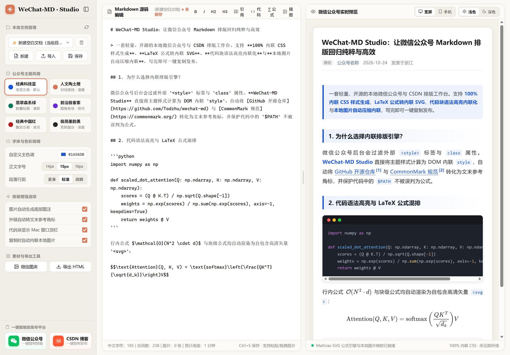
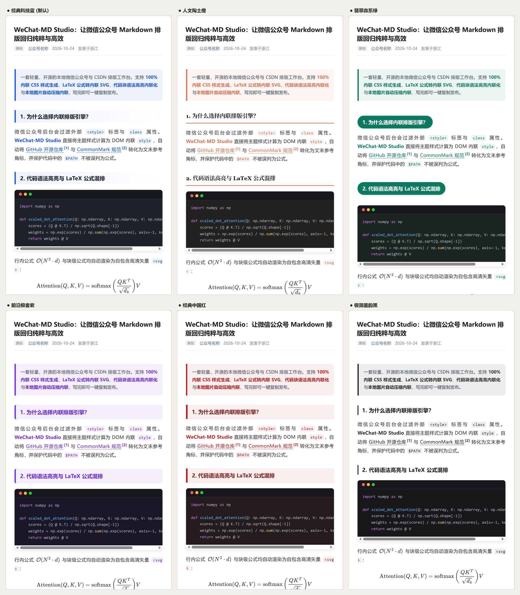
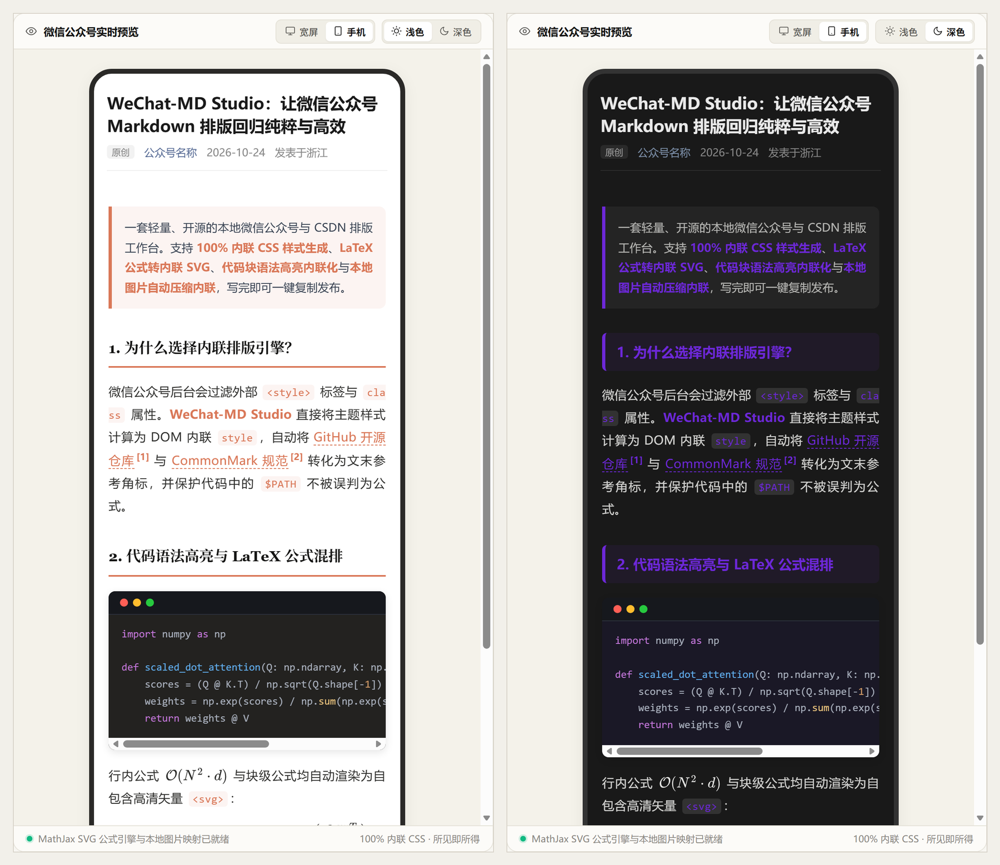

# WeChat-MD Studio — 微信公众号排版工作台

**WeChat-MD Studio** 是一款轻量、开箱即用的本地开源微信公众号与 CSDN 博客 Markdown 排版工具。采用 **Claude 风格左侧控制台 + 右侧可调双栏实时预览（Artifacts）** 界面架构，提供 **100% 内联 CSS 富文本生成**、**LaTeX 数学公式转内联 SVG**、**代码块语法高亮内联化与 Mac 窗口顶栏**、**本地图片实时映射 / 自动压缩内联 / 微信官方图床直传** 等完整能力，解决 Markdown 创作者在微信公众号后台排版繁琐、公式变形、代码丢色、外链不可点击与图片上传麻烦等核心痛点。

---

## 界面预览

### 1. 工作台全景（左侧控制台 + 可调双栏源码编辑与实时渲染）


### 2. 内置 6 套精选排版主题对比


### 3. 手机仿真视图（390px）与浅色 / 深色模式预览


---

## 核心特性

### 1. 微信公众号 100% 兼容排版引擎
- **全内联样式（Inline CSS）**：所有标题、段落、列表、引用块、分割线、表格与代码块均在 DOM 树层面直接注入内联 `style`，一键复制粘贴到微信公众号后台不丢任何样式。
- **内置 6 套精选主题**：
  - **经典科技蓝**（`bioinfo-blue`）：渐变左框二级标题，清爽干练（默认）
  - **人文陶土橙**（`claude-terracotta`）：衬线底线标题，温暖人文质感
  - **翡翠森系绿**（`nature-emerald`）：圆角胶囊章节标题，清新醒目
  - **前沿极客紫**（`ai-violet`）：圆角色块标题，现代科技风格
  - **经典中国红**（`cns-crimson`）：醒目左框标题，适合资讯与重点速递
  - **极简墨韵黑**（`minimal-ink`）：克制留白设计，适合深度长文阅读
- **细节自由定制**：支持自定义任意主题主色调、正文字号（`14px / 15px / 16px`）与段落行距（`1.75 / 1.85 / 2.0`），所有配置自动记忆。

### 2. 富文本排版增强
- **LaTeX 数学公式无损转内联 SVG**：基于 MathJax 3 将行内公式 `$...$` 与块级公式 `$$...$$` 渲染为自包含内联 `<svg>` 矢量图，粘贴到微信公众号无需任何外挂字体即可高清显示；同时在解析前自动保护代码块与行内代码中的 `$` 符号（如 Shell `$PATH`、R 语言 `df$col`），杜绝误解析。
- **代码语法高亮内联化 + Mac 窗口顶栏**：基于 Highlight.js 自动识别语言并将语法高亮颜色转换为内联 `style="color: ..."`，粘贴到微信公众号后台后依然保留完整代码配色；支持一键开启/关闭 Mac 风格红黄绿圆点顶栏。
- **图片自动生成底部图注**：支持自动提取 Markdown 图片语法 `` 中的描述文本，在图片正下方生成居中的 `▲ 图注内容` 说明。
- **外链自动转文末参考角标**：自动将正文中的非微信外部链接转换为上标角标 `[1]`，并在文章末尾自动汇总生成「参考链接」卡片，解决个人公众号正文无法直接跳转外部链接的限制。

### 3. 本地图片无缝流转与多平台一键发布
- **本地路径实时映射**：Markdown 中引用的相对路径（如 `./figures/demo.png`）或本地磁盘绝对路径均可由本地服务实时代理渲染。
- **截图直接粘贴 & 文件拖拽导入**：支持在编辑器中直接 `Ctrl + V` 粘贴剪贴板截图，或将本地图片 / `.md` 文档直接拖入窗口。
- **三种图片发布方案**：
  1. **免配置自动压缩内联（默认）**：点击「一键复制 · 微信公众号」时，后端基于 Pillow 自动将本地图片按最大宽度 `1080px` 等比缩放并压缩为高清 JPEG Base64 嵌入剪贴板，无需配置图床即可直接粘贴。
  2. **微信官方图床直传（可选）**：在左侧栏填写公众号 `AppID` 与 `AppSecret`（注意将本机公网 IP 加入公众号后台白名单），即可一键将正文中所有本地图片批量上传至微信官方 `media/uploadimg` 接口并替换为 `https://mmbiz.qpic.cn/...` 永久链接（不占用公众号 5000 张永久素材上限）。
  3. **独立 HTML 离线导出**：一键导出内联全部样式与图片的单个 `.html` 文件，方便归档与离线分享。
- **双平台一键复制**：
  - **微信公众号**：复制 100% 内联 CSS 富文本，在公众号后台直接 `Ctrl + V` 即可。
  - **CSDN 博客**：同时向剪贴板写入富文本 HTML 与纯净 Markdown（外链与代码块保持原样），无论使用 CSDN 的 Markdown 编辑器还是富文本编辑器均可直接粘贴。

### 4. 现代化双栏编辑器体验
- **可拖拽分栏分隔条**：源码编辑区与实时预览区之间支持鼠标左右拖动调节宽度比例（`22% ~ 78%`），**双击分隔条**一键恢复 `50% : 50%` 等宽。
- **仿真预览与页眉内联编辑**：支持 **宽屏模式 / 手机视图（390px）** 与 **浅色 / 深色** 预览切换；预览区顶部的文章标题、原创标识、公众号名称与发布地区均可直接点击修改并自动保存。
- **本地文档管理与防丢稿机制**：
  - 支持在本地工作区新建、保存、切换与一键删除 `.md` 文档；
  - 编辑内容实时防抖缓存至浏览器本地草稿箱（`localStorage`），未保存关闭页面时自动提醒；
  - 保存本地文件时支持外部修改冲突检测（`409 Conflict`）与原子写入，防止意外覆盖。

---

## 项目结构

```text
wechat-md/
├── server.py               # Python 多线程后端服务（静态资源、文件管理、图片压缩与微信 API）
├── 启动排版工作台.bat       # Windows 一键启动脚本
├── requirements.txt        # Python 依赖（Pillow）
├── static/
│   ├── index.html          # 工作台主界面（左侧设置栏 + 右侧可调双栏）
│   ├── style.css           # 界面样式表与响应式布局
│   └── app.js              # Markdown / MathJax / Highlight 内联渲染引擎与交互逻辑
├── docs/
│   └── screenshots/        # README 实机界面演示截图
├── workspace/              # 默认本地文档工作区目录（自动创建）
└── uploads/                # 粘贴或上传图片的本地去重存储目录（自动创建）
```

---

## 快速开始

### 1. 环境要求
- **Python 3.8+**
- 安装图片自适应压缩依赖 `Pillow`（推荐）：
  ```bash
  pip install -r requirements.txt
  ```

### 2. 启动工作台
- **Windows 一键启动**：双击运行 [`启动排版工作台.bat`](./启动排版工作台.bat)，浏览器将自动打开工作台。
- **命令行启动**：
  ```bash
  python server.py 8765 --open
  ```
  启动后在浏览器访问：`http://127.0.0.1:8765`

---

## 环境变量配置（可选）

| 环境变量 | 说明 | 默认值 |
| :--- | :--- | :--- |
| `WECHAT_MD_WORKSPACE` | 默认扫描与保存 `.md` 文档的工作区目录 | 项目下 `./workspace` |
| `WECHAT_MD_ROOT` | 允许读写 `.md` 文档的根目录安全范围 | 与工作区目录相同 |

---

## 常用快捷键与操作指南

| 操作 | 快捷键 / 方式 |
| :--- | :--- |
| 保存当前文档到本地工作区 | `Ctrl + S`（macOS 为 `Cmd + S`） |
| 选中文字加粗 | `Ctrl + B` |
| 选中文字斜体 | `Ctrl + I` |
| 代码 / 列表缩进与反缩进 | `Tab` / `Shift + Tab` |
| 插入剪贴板截图 | 在源码编辑区直接 `Ctrl + V` |
| 导入外部 `.md` 文档或图片 | 将文件直接拖入浏览器工作区窗口 |
| 调节左右分栏宽度 | 按住中间分隔条左右拖动；**双击分隔条**恢复 `50% : 50%` 等宽 |

---

## 开源协议

本项目基于 [MIT License](https://opensource.org/licenses/MIT) 开源，欢迎提交 Issue 与 Pull Request。
